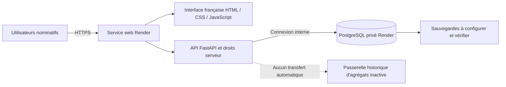

# Conception de la plateforme SISA v0.3

## Architecture effectivement réalisée

Le navigateur et l’API partagent la même origine. L’interface n’utilise aucun CDN, police distante, service analytique ou stockage navigateur de jeton. Les cookies de session sont HttpOnly, SameSite Strict, Secure en mode Render. Le header CSRF est requis pour les écritures utilisant le cookie ; les clients bearer historiques restent compatibles. Le changement de mot de passe révoque toutes les sessions du compte. Le contrôle d’origine et la politique CSP limitent l’intégration et l’exécution de scripts externes.

Les données sont stockées via `db()` : SQLite reste disponible en local ; un adaptateur PostgreSQL ciblé prend en charge les requêtes paramétrées héritées. Il traduit uniquement les placeholders internes, les insertions à identifiant généré et l’initialisation du schéma ; ce n’est pas un traducteur SQL général. Les conflits d’intégrité sont retournés en 409 après rollback. Les corrections de dossier prennent un verrou PostgreSQL et peuvent contrôler la version attendue ; l’interface transmet cette version.

L’initialisation du schéma est additive et idempotente (`CREATE IF NOT EXISTS`) avec verrou consultatif PostgreSQL. Il n’existe pas encore de moteur général de migrations destructives ; toute évolution relationnelle devra inclure une migration versionnée, son test de restauration et son plan de retour. Aucune conversion automatique d’une base SQLite réelle n’est fournie.

## Écrans et capacités

| Écran | Capacité implémentée | Limite explicite |
|---|---|---|
| Accueil/connexion | initialisation protégée, connexion, logout | pas de SSO/MFA ni récupération de mot de passe autonome |
| Vue d’ensemble | compteurs de statuts, répartition, dossiers récents | aucun chiffre de démonstration inventé ; base vide au démarrage |
| Dossiers | création/consultation/correction, dates, RP/RI, catégorie et effectifs | clé RP+année héritée ; juridiction et relations complètes à cadrer |
| Validation | soumission, validation, retour motivé | validation institutionnelle des rapports distincte et non implémentée |
| Imports | CSV/XLSX, contrôle, échantillon, confirmation et historique | mapping fixe ; pas d’éditeur de correspondances ni reprise réelle autorisée |
| Statistiques | période, dossiers validés, ventilations provisoires | pas de catalogue officiel complet ni personnes distinctes |
| Exports | CSV, Excel et PDF | dossiers CSV/XLSX tous statuts ; PDF statistique provisoire |
| Qualité | trois règles explicables | ni IA/ML ni détection exhaustive |
| Audit | traces, auteur, détails de correction | journal en base modifiable par un administrateur de stockage ; conservation à approuver |
| Utilisateurs | création collector/supervisor, activation/désactivation | plafond de comptes, annuaire et administration technique temporaire à cadrer |
| Paramètres | changement de mot de passe et état d’exploitation | planification/chiffrement des sauvegardes à organiser dans l’environnement cible |

## Autorisations conservées

| Action | Agent | Superviseur | Admin |
|---|---|---|---|
| Consulter dossiers/statistiques, créer, importer, soumettre | oui | oui | oui |
| Corriger dossier non validé | oui | oui | oui |
| Corriger dossier validé avec motif | non | oui | oui |
| Valider/retourner, exporter, audit et anomalies | non | oui | oui |
| Lister les utilisateurs | non | oui | oui |
| Créer/désactiver un compte, voir exploitation | non | non | oui |
| Changer son propre mot de passe | oui | oui | oui |

Le périmètre de visibilité est le site entier, sans cloisonnement par juridiction ou propriétaire. Cette matrice technique hérite du prototype et doit être approuvée par le responsable fonctionnel avant tout usage réel. Un administrateur ne peut pas se désactiver lui-même ; les comptes administrateurs ne sont pas désactivables par l’interface courante.

## Intégrité des imports et événements

Les entiers importés sont lus comme des décimaux exacts : `1.0` représente un entier et est accepté ; `1.9`, `NaN` et les valeurs infinies sont rejetés. Les champs vides restent inconnus ; zéro est conservé et affiché comme zéro. Les effectifs sont bornés par la capacité technique INTEGER PostgreSQL (2 147 483 647), sans présumer une borne métier acceptable. Année et date restent contrôlées. La lecture du fichier est bornée à 15 Mo ; XLSX décompressé à 60 Mo, 256 colonnes et 10 000 lignes de données. Ces limites techniques ne sont pas un benchmark de capacité.

Sur PostgreSQL, l’aperçu est en base avec propriétaire, expiration et suppression après confirmation ; le verrou de ligne empêche une double confirmation concurrente. La purge des aperçus de plus de trente minutes intervient lors de la création d’un nouvel aperçu : ce n’est pas encore une politique de rétention planifiée. Un utilisateur refusé ne supprime pas l’aperçu d’un tiers. Le mode local conserve les fichiers d’aperçu pour compatibilité ; sa purge opérationnelle reste à prévoir.

Les montants d’événements doivent être décimaux finis et non négatifs. Les chaînes exactes sont conservées ; la devise, les natures et les règles de précision restent à définir. L’ajout d’événement à un dossier validé est bloqué : le dossier doit d’abord être corrigé avec motif et remis en brouillon. Ce verrou conservateur empêche la modification silencieuse d’un dossier déjà validé ; le workflow complet de correction événementielle reste à faire approuver.

Les valeurs textuelles commençant par une formule de tableur ou certains contrôles sont neutralisées à la sortie CSV/XLSX, sans changer la valeur enregistrée en base.

## Périmètre restant à valider

La plateforme peut être démontrée avec des données fictives. Elle n’est pas déclarée conforme à l’ensemble du TDR : modèle personnes/décisions/mesures, juridiction, règles des indicateurs, nomenclatures, réversibilité complète, conservation, sauvegardes chiffrées, disponibilité LAN hors Internet, charge institutionnelle, formation et revue indépendante restent ouverts. L’hébergement cloud ne remplace pas le réseau local autonome prescrit par le TDR.

L’indicateur de mode synthétique est une restriction d’usage et de configuration, pas un mécanisme capable de reconnaître les données réelles dans un fichier. Toute modification de cette politique exige un arbitrage humain explicite.
